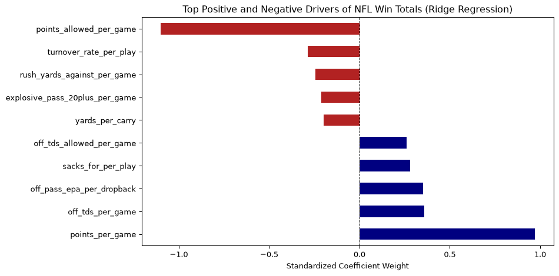
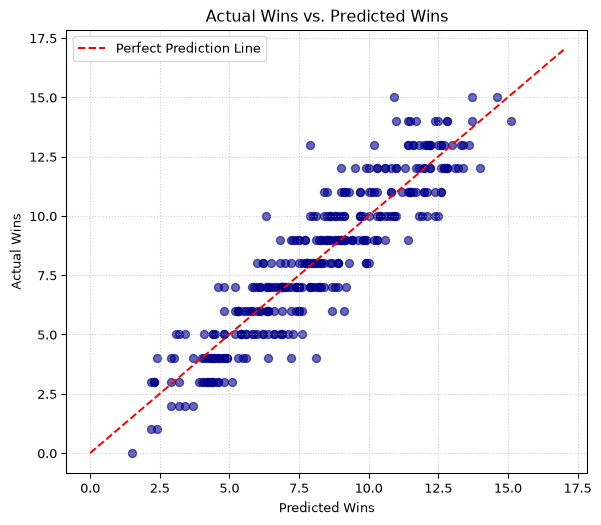
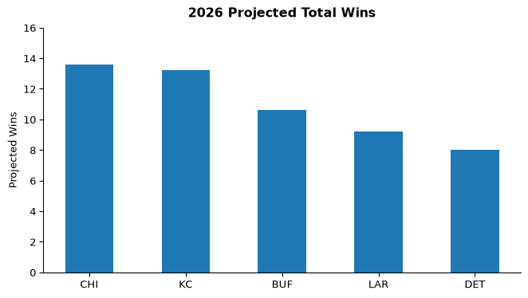

# Predicting NFL Team Success


# loaded in data with pandas, The data set contains any metric I thought might be relevant for predicting NFL wins and losses.

``` python
import numpy as np
import pandas as pd
import statsmodels.api as sm

df = pd.read_csv("~/Downloads/nfl_team_season_stats_2015_2025.csv")
```

\#view the data

``` python
df.head()
```

<div>
<style scoped>
    .dataframe tbody tr th:only-of-type {
        vertical-align: middle;
    }
&#10;    .dataframe tbody tr th {
        vertical-align: top;
    }
&#10;    .dataframe thead th {
        text-align: right;
    }
</style>

|  | season | team | games | wins | losses | ties | win_pct | points_per_game | points_allowed_per_game | point_diff_per_game | ... | sack_rate_for_per_dropback | qb_hits_per_dropback | def_interceptions_per_game | def_tds_per_game | off_tds_allowed_per_game | turnover_margin_per_game | epa_per_play_differential | penalties_per_game | penalty_yards_per_game | fg_pct |
|----|----|----|----|----|----|----|----|----|----|----|----|----|----|----|----|----|----|----|----|----|----|
| 0 | 2015 | ARI | 16 | 13 | 3 | 0 | 0.8125 | 30.5625 | 19.5625 | 11.0000 | ... | 0.0575 | 0.1757 | 1.1875 | 0.2500 | 2.0625 | 0.5625 | 0.2149 | 5.8750 | 47.3750 | 0.9032 |
| 1 | 2015 | ATL | 16 | 8 | 8 | 0 | 0.5000 | 21.1875 | 21.5625 | -0.3750 | ... | 0.0328 | 0.1293 | 0.9375 | 0.0625 | 2.4375 | -0.3125 | -0.0040 | 6.2500 | 60.5625 | 0.8065 |
| 2 | 2015 | BAL | 16 | 5 | 11 | 0 | 0.3125 | 20.5000 | 25.0625 | -4.5625 | ... | 0.0636 | 0.1615 | 0.3750 | 0.0625 | 2.5000 | -0.8750 | -0.0809 | 7.6250 | 72.0625 | 0.8250 |
| 3 | 2015 | BUF | 16 | 8 | 8 | 0 | 0.5000 | 23.6875 | 22.4375 | 1.2500 | ... | 0.0337 | 0.1204 | 1.0625 | 0.1250 | 2.5000 | 0.3125 | 0.0210 | 8.9375 | 78.0625 | 0.8519 |
| 4 | 2015 | CAR | 16 | 15 | 1 | 0 | 0.9375 | 31.2500 | 19.2500 | 12.0000 | ... | 0.0634 | 0.1585 | 1.5000 | 0.2500 | 2.0000 | 1.0625 | 0.2028 | 6.4375 | 55.4375 | 0.8333 |

<p>5 rows × 50 columns</p>
</div>

``` python
df.columns
```

    Index(['season', 'team', 'games', 'wins', 'losses', 'ties', 'win_pct',
           'points_per_game', 'points_allowed_per_game', 'point_diff_per_game',
           'off_epa_per_play', 'off_pass_epa_per_dropback',
           'off_rush_epa_per_carry', 'yards_per_game', 'pass_yards_per_game',
           'rush_yards_per_game', 'yards_per_play', 'yards_per_carry',
           'net_yards_per_dropback', 'completion_pct', 'pass_rate',
           'plays_per_game', 'first_down_pct_per_play', 'turnover_rate_per_play',
           'interceptions_per_dropback', 'sacks_against_per_play',
           'sack_rate_against_per_dropback', 'off_tds_per_game',
           'explosive_pass_20plus_per_game', 'explosive_rush_20plus_per_game',
           'def_epa_per_play_allowed', 'def_pass_epa_per_dropback_allowed',
           'def_rush_epa_per_carry_allowed', 'yards_against_per_game',
           'pass_yards_against_per_game', 'rush_yards_against_per_game',
           'yards_per_play_allowed', 'first_down_pct_allowed_per_play',
           'takeaway_rate_per_play', 'sacks_for_per_play',
           'sack_rate_for_per_dropback', 'qb_hits_per_dropback',
           'def_interceptions_per_game', 'def_tds_per_game',
           'off_tds_allowed_per_game', 'turnover_margin_per_game',
           'epa_per_play_differential', 'penalties_per_game',
           'penalty_yards_per_game', 'fg_pct'],
          dtype='str')

\#decided to drop everything that highly correlates wiith wins so the
when I do my correlation matrix the obvious metrics don’t show up

``` python
df_clean = df.drop(columns=['season', 'team', 'games', 'losses', 'ties', 'win_pct'])
```

\#review the cleaned data

``` python
df_clean.head()
```

<div>
<style scoped>
    .dataframe tbody tr th:only-of-type {
        vertical-align: middle;
    }
&#10;    .dataframe tbody tr th {
        vertical-align: top;
    }
&#10;    .dataframe thead th {
        text-align: right;
    }
</style>

|  | wins | points_per_game | points_allowed_per_game | point_diff_per_game | off_epa_per_play | off_pass_epa_per_dropback | off_rush_epa_per_carry | yards_per_game | pass_yards_per_game | rush_yards_per_game | ... | sack_rate_for_per_dropback | qb_hits_per_dropback | def_interceptions_per_game | def_tds_per_game | off_tds_allowed_per_game | turnover_margin_per_game | epa_per_play_differential | penalties_per_game | penalty_yards_per_game | fg_pct |
|----|----|----|----|----|----|----|----|----|----|----|----|----|----|----|----|----|----|----|----|----|----|
| 0 | 13 | 30.5625 | 19.5625 | 11.0000 | 0.1102 | 0.2419 | -0.0614 | 428.1875 | 308.3750 | 119.8125 | ... | 0.0575 | 0.1757 | 1.1875 | 0.2500 | 2.0625 | 0.5625 | 0.2149 | 5.8750 | 47.3750 | 0.9032 |
| 1 | 8 | 21.1875 | 21.5625 | -0.3750 | -0.0006 | 0.1108 | -0.1739 | 401.9375 | 301.5625 | 100.3750 | ... | 0.0328 | 0.1293 | 0.9375 | 0.0625 | 2.4375 | -0.3125 | -0.0040 | 6.2500 | 60.5625 | 0.8065 |
| 2 | 5 | 20.5000 | 25.0625 | -4.5625 | -0.0679 | -0.0266 | -0.1432 | 381.5625 | 289.1875 | 92.3750 | ... | 0.0636 | 0.1615 | 0.3750 | 0.0625 | 2.5000 | -0.8750 | -0.0809 | 7.6250 | 72.0625 | 0.8250 |
| 3 | 8 | 23.6875 | 22.4375 | 1.2500 | 0.0508 | 0.0859 | 0.0159 | 393.0625 | 241.0625 | 152.0000 | ... | 0.0337 | 0.1204 | 1.0625 | 0.1250 | 2.5000 | 0.3125 | 0.0210 | 8.9375 | 78.0625 | 0.8519 |
| 4 | 15 | 31.2500 | 19.2500 | 12.0000 | 0.0875 | 0.1608 | 0.0132 | 402.4375 | 259.8125 | 142.6250 | ... | 0.0634 | 0.1585 | 1.5000 | 0.2500 | 2.0000 | 1.0625 | 0.2028 | 6.4375 | 55.4375 | 0.8333 |

<p>5 rows × 44 columns</p>
</div>

\#used .corr() to find the correlation of each numeric feature’s
correlation to wins

``` python
correlations = df_clean.corr(numeric_only=True)['wins'].sort_values(ascending=False)
```

# stats correlated with winning

``` python
print(correlations.head(10))
```

    wins                         1.000000
    point_diff_per_game          0.896742
    epa_per_play_differential    0.854452
    points_per_game              0.751558
    off_pass_epa_per_dropback    0.696417
    off_epa_per_play             0.682448
    turnover_margin_per_game     0.671634
    off_tds_per_game             0.668792
    takeaway_rate_per_play       0.557068
    first_down_pct_per_play      0.542213
    Name: wins, dtype: float64

# stats correlated with losing

``` python
print(correlations.tail(10))
```

    pass_rate                           -0.356461
    sack_rate_against_per_dropback      -0.405890
    interceptions_per_dropback          -0.413817
    rush_yards_against_per_game         -0.468924
    sacks_against_per_play              -0.510807
    def_epa_per_play_allowed            -0.513783
    off_tds_allowed_per_game            -0.516219
    turnover_rate_per_play              -0.543844
    def_pass_epa_per_dropback_allowed   -0.564816
    points_allowed_per_game             -0.662945
    Name: wins, dtype: float64

\#import new libraries in order to run ridge model

\#dropped more columns that were too obvious and completely skewed the
model I also tried out a random forrest model that I deleted,but I
prefered the ridge model due to the random forrest model having higher
dependance on one to two variables

``` python
X = df_clean.drop(columns=['wins', 'point_diff_per_game','epa_per_play_differential'])
Y = df_clean['wins']
```

# import more libraries for scaling and ridge regression

``` python
from sklearn.linear_model import Ridge
from sklearn.preprocessing import StandardScaler
from sklearn.metrics import mean_absolute_error, r2_score
```

\#Scaled the features before fitting the ridge regression model.

``` python
scaler = StandardScaler()
X_scaled = scaler.fit_transform(X)
```

\#run the ridge regression model

``` python
ridge_model = Ridge(alpha=10.0)
ridge_model.fit(X_scaled, Y)
```

<style>.sk-global {
  /* Definition of color scheme common for light and dark mode */
  --sklearn-color-text: #000;
  --sklearn-color-text-muted: #666;
  --sklearn-color-line: gray;
  /* Definition of color scheme for unfitted estimators */
  --sklearn-color-unfitted-level-0: #fff5e6;
  --sklearn-color-unfitted-level-1: #f6e4d2;
  --sklearn-color-unfitted-level-2: #ffe0b3;
  --sklearn-color-unfitted-level-3: chocolate;
  /* Definition of color scheme for fitted estimators */
  --sklearn-color-fitted-level-0: #f0f8ff;
  --sklearn-color-fitted-level-1: #d4ebff;
  --sklearn-color-fitted-level-2: #b3dbfd;
  --sklearn-color-fitted-level-3: cornflowerblue;
}
&#10;.sk-global.light {
  /* Specific color for light theme */
  --sklearn-color-text-on-default-background: black;
  --sklearn-color-background: white;
  --sklearn-color-border-box: black;
  --sklearn-color-icon: #696969;
}
&#10;.sk-global.dark {
  --sklearn-color-text-on-default-background: white;
  --sklearn-color-background: #111;
  --sklearn-color-border-box: white;
  --sklearn-color-icon: #878787;
}
&#10;.sk-global {
  color: var(--sklearn-color-text);
}
&#10;.sk-global pre {
  padding: 0;
}
&#10;.sk-global input.sk-hidden--visually {
  border: 0;
  clip-path: inset(100%);
  height: 1px;
  margin: -1px;
  overflow: hidden;
  padding: 0;
  position: absolute;
  width: 1px;
}
&#10;.sk-global div.sk-dashed-wrapped {
  border: 1px dashed var(--sklearn-color-line);
  margin: 0 0.4em 0.5em 0.4em;
  box-sizing: border-box;
  padding-bottom: 0.4em;
  background-color: var(--sklearn-color-background);
}
&#10;.sk-global div.sk-container {
  /* jupyter's `normalize.less` sets `[hidden] { display: none; }`
     but bootstrap.min.css set `[hidden] { display: none !important; }`
     so we also need the `!important` here to be able to override the
     default hidden behavior on the sphinx rendered scikit-learn.org.
     See: https://github.com/scikit-learn/scikit-learn/issues/21755 */
  display: inline-block !important;
  position: relative;
}
&#10;.sk-global div.sk-text-repr-fallback {
  display: none;
}
&#10;div.sk-parallel-item,
div.sk-serial,
div.sk-item {
  /* draw centered vertical line to link estimators */
  background-image: linear-gradient(var(--sklearn-color-text-on-default-background), var(--sklearn-color-text-on-default-background));
  background-size: 2px 100%;
  background-repeat: no-repeat;
  background-position: center center;
}
&#10;/* Parallel-specific style estimator block */
&#10;.sk-global div.sk-parallel-item::after {
  content: "";
  width: 100%;
  border-bottom: 2px solid var(--sklearn-color-text-on-default-background);
  flex-grow: 1;
}
&#10;.sk-global div.sk-parallel {
  display: flex;
  align-items: stretch;
  justify-content: center;
  background-color: var(--sklearn-color-background);
  position: relative;
}
&#10;.sk-global div.sk-parallel-item {
  display: flex;
  flex-direction: column;
}
&#10;.sk-global div.sk-parallel-item:first-child::after {
  align-self: flex-end;
  width: 50%;
}
&#10;.sk-global div.sk-parallel-item:last-child::after {
  align-self: flex-start;
  width: 50%;
}
&#10;.sk-global div.sk-parallel-item:only-child::after {
  width: 0;
}
&#10;/* Serial-specific style estimator block */
&#10;.sk-global div.sk-serial {
  display: flex;
  flex-direction: column;
  align-items: center;
  background-color: var(--sklearn-color-background);
  padding-right: 1em;
  padding-left: 1em;
}
&#10;
/* Toggleable style: style used for estimator/Pipeline/ColumnTransformer box that is
clickable and can be expanded/collapsed.
- Pipeline and ColumnTransformer use this feature and define the default style
- Estimators will overwrite some part of the style using the `sk-estimator` class
*/
&#10;/* Pipeline and ColumnTransformer style (default) */
&#10;.sk-global div.sk-toggleable {
  /* Default theme specific background. It is overwritten whether we have a
  specific estimator or a Pipeline/ColumnTransformer */
  background-color: var(--sklearn-color-background);
}
&#10;/* Toggleable label */
.sk-global label.sk-toggleable__label {
  cursor: pointer;
  display: flex;
  width: 100%;
  margin-bottom: 0;
  padding: 0.5em;
  box-sizing: border-box;
  text-align: center;
  align-items: center;
  justify-content: center;
  gap: 0.5em;
}
&#10;.sk-global label.sk-toggleable__label .caption {
  font-size: 0.6rem;
  font-weight: lighter;
  color: var(--sklearn-color-text-muted);
}
&#10;.sk-global label.sk-toggleable__label-arrow:before {
  /* Arrow on the left of the label */
  content: "▸";
  float: left;
  margin-right: 0.25em;
  color: var(--sklearn-color-icon);
}
&#10;.sk-global label.sk-toggleable__label-arrow:hover:before {
  color: var(--sklearn-color-text);
}
&#10;/* Toggleable content - dropdown */
&#10;.sk-global div.sk-toggleable__content {
  display: none;
  text-align: left;
  /* unfitted */
  background-color: var(--sklearn-color-unfitted-level-0);
}
&#10;.sk-global div.sk-toggleable__content.fitted {
  /* fitted */
  background-color: var(--sklearn-color-fitted-level-0);
}
&#10;.sk-global div.sk-toggleable__content pre {
  margin: 0.2em;
  border-radius: 0.25em;
  color: var(--sklearn-color-text);
  /* unfitted */
  background-color: var(--sklearn-color-unfitted-level-0);
}
&#10;.sk-global div.sk-toggleable__content.fitted pre {
  /* unfitted */
  background-color: var(--sklearn-color-fitted-level-0);
}
&#10;.sk-global input.sk-toggleable__control:checked~div.sk-toggleable__content {
  /* Expand drop-down */
  display: block;
  width: 100%;
  overflow: visible;
}
&#10;.sk-global input.sk-toggleable__control:checked~label.sk-toggleable__label-arrow:before {
  content: "▾";
}
&#10;/* Pipeline/ColumnTransformer-specific style */
&#10;.sk-global div.sk-label input.sk-toggleable__control:checked~label.sk-toggleable__label {
  color: var(--sklearn-color-text);
  background-color: var(--sklearn-color-unfitted-level-2);
}
&#10;.sk-global div.sk-label.fitted input.sk-toggleable__control:checked~label.sk-toggleable__label {
  background-color: var(--sklearn-color-fitted-level-2);
}
&#10;/* Estimator-specific style */
&#10;/* Colorize estimator box */
.sk-global div.sk-estimator input.sk-toggleable__control:checked~label.sk-toggleable__label {
  /* unfitted */
  background-color: var(--sklearn-color-unfitted-level-2);
}
&#10;.sk-global div.sk-estimator.fitted input.sk-toggleable__control:checked~label.sk-toggleable__label {
  /* fitted */
  background-color: var(--sklearn-color-fitted-level-2);
}
&#10;.sk-global div.sk-label label.sk-toggleable__label,
.sk-global div.sk-label label {
  /* The background is the default theme color */
  color: var(--sklearn-color-text-on-default-background);
}
&#10;/* On hover, darken the color of the background */
.sk-global div.sk-label:hover label.sk-toggleable__label {
  color: var(--sklearn-color-text);
  background-color: var(--sklearn-color-unfitted-level-2);
}
&#10;/* Label box, darken color on hover, fitted */
.sk-global div.sk-label.fitted:hover label.sk-toggleable__label.fitted {
  color: var(--sklearn-color-text);
  background-color: var(--sklearn-color-fitted-level-2);
}
&#10;/* Estimator label */
&#10;.sk-global div.sk-label label {
  font-family: monospace;
  font-weight: bold;
  line-height: 1.2em;
}
&#10;.sk-global div.sk-label-container {
  text-align: center;
}
&#10;/* Estimator-specific */
.sk-global div.sk-estimator {
  font-family: monospace;
  border: 1px dotted var(--sklearn-color-border-box);
  border-radius: 0.25em;
  box-sizing: border-box;
  margin-bottom: 0.5em;
  /* unfitted */
  background-color: var(--sklearn-color-unfitted-level-0);
}
&#10;.sk-global div.sk-estimator.fitted {
  /* fitted */
  background-color: var(--sklearn-color-fitted-level-0);
}
&#10;/* on hover */
.sk-global div.sk-estimator:hover {
  /* unfitted */
  background-color: var(--sklearn-color-unfitted-level-2);
}
&#10;.sk-global div.sk-estimator.fitted:hover {
  /* fitted */
  background-color: var(--sklearn-color-fitted-level-2);
}
&#10;/* Specification for estimator info (e.g. "i" and "?") */
&#10;/* Common style for "i" and "?" */
&#10;.sk-estimator-doc-link,
a:link.sk-estimator-doc-link,
a:visited.sk-estimator-doc-link {
  float: right;
  font-size: smaller;
  line-height: 1em;
  font-family: monospace;
  background-color: var(--sklearn-color-unfitted-level-0);
  border-radius: 1em;
  height: 1em;
  width: 1em;
  text-decoration: none !important;
  margin-left: 0.5em;
  text-align: center;
  /* unfitted */
  border: var(--sklearn-color-unfitted-level-3) 1pt solid;
  color: var(--sklearn-color-unfitted-level-3);
}
&#10;.sk-estimator-doc-link.fitted,
a:link.sk-estimator-doc-link.fitted,
a:visited.sk-estimator-doc-link.fitted {
  /* fitted */
  background-color: var(--sklearn-color-fitted-level-0);
  border: var(--sklearn-color-fitted-level-3) 1pt solid;
  color: var(--sklearn-color-fitted-level-3);
}
&#10;/* On hover */
div.sk-estimator:hover .sk-estimator-doc-link:hover,
.sk-estimator-doc-link:hover,
div.sk-label-container:hover .sk-estimator-doc-link:hover,
.sk-estimator-doc-link:hover {
  /* unfitted */
  background-color: var(--sklearn-color-unfitted-level-3);
  border: var(--sklearn-color-fitted-level-0) 1pt solid;
  color: var(--sklearn-color-unfitted-level-0);
  text-decoration: none;
}
&#10;div.sk-estimator.fitted:hover .sk-estimator-doc-link.fitted:hover,
.sk-estimator-doc-link.fitted:hover,
div.sk-label-container:hover .sk-estimator-doc-link.fitted:hover,
.sk-estimator-doc-link.fitted:hover {
  /* fitted */
  background-color: var(--sklearn-color-fitted-level-3);
  border: var(--sklearn-color-fitted-level-0) 1pt solid;
  color: var(--sklearn-color-fitted-level-0);
  text-decoration: none;
}
&#10;/* Span, style for the box shown on hovering the info icon */
.sk-estimator-doc-link span {
  display: none;
  z-index: 9999;
  position: relative;
  font-weight: normal;
  right: .2ex;
  padding: .5ex;
  margin: .5ex;
  width: min-content;
  min-width: 20ex;
  max-width: 50ex;
  color: var(--sklearn-color-text);
  box-shadow: 2pt 2pt 4pt #999;
  /* unfitted */
  background: var(--sklearn-color-unfitted-level-0);
  border: .5pt solid var(--sklearn-color-unfitted-level-3);
}
&#10;.sk-estimator-doc-link.fitted span {
  /* fitted */
  background: var(--sklearn-color-fitted-level-0);
  border: var(--sklearn-color-fitted-level-3);
}
&#10;.sk-estimator-doc-link:hover span {
  display: block;
}
&#10;/* "?"-specific style due to the `<a>` HTML tag */
&#10;.sk-global a.estimator_doc_link {
  float: right;
  font-size: 1rem;
  line-height: 1em;
  font-family: monospace;
  background-color: var(--sklearn-color-unfitted-level-0);
  border-radius: 1rem;
  height: 1rem;
  width: 1rem;
  text-decoration: none;
  /* unfitted */
  color: var(--sklearn-color-unfitted-level-1);
  border: var(--sklearn-color-unfitted-level-1) 1pt solid;
}
&#10;.sk-global a.estimator_doc_link.fitted {
  /* fitted */
  background-color: var(--sklearn-color-fitted-level-0);
  border: var(--sklearn-color-fitted-level-1) 1pt solid;
  color: var(--sklearn-color-fitted-level-1);
}
&#10;/* On hover */
.sk-global a.estimator_doc_link:hover {
  /* unfitted */
  background-color: var(--sklearn-color-unfitted-level-3);
  color: var(--sklearn-color-background);
  text-decoration: none;
}
&#10;.sk-global a.estimator_doc_link.fitted:hover {
  /* fitted */
  background-color: var(--sklearn-color-fitted-level-3);
}
&#10;.sk-top-container.sk-global {
  /* pydata-sphinx-theme hides overflow, so scrolling is disabled.
   We need to set it to !important and add tabindex="0" in the HTML
   to allow keyboard-only users to navigate the display. */
  overflow-x: scroll !important;
  max-width: 100%;
}
&#10;.estimator-table {
    font-family: monospace;
}
&#10;.estimator-table summary {
    padding: .5rem;
    cursor: pointer;
}
&#10;.estimator-table summary::marker {
    font-size: 0.7rem;
}
&#10;.estimator-table details[open] {
    padding-left: 0.1rem;
    padding-right: 0.1rem;
    padding-bottom: 0.3rem;
}
&#10;.estimator-table .parameters-table {
    margin-left: auto !important;
    margin-right: auto !important;
    margin-top: 0;
}
&#10;.estimator-table .parameters-table tr:nth-child(odd) {
    background-color: #fff;
}
&#10;.estimator-table .parameters-table tr:nth-child(even) {
    background-color: #f6f6f6;
}
&#10;.estimator-table .parameters-table tr:hover td {
    background-color: #e0e0e0;
}
&#10;.estimator-table table :is(td, th) {
    border: 1px solid rgba(106, 105, 104, 0.232);
}
&#10;/*
    `table td`is set in notebook with right text-align.
    We need to overwrite it.
*/
.estimator-table table td.param {
    text-align: left;
    position: relative;
    padding: 0;
}
&#10;.user-set td {
    color:rgb(255, 94, 0);
    text-align: left !important;
}
&#10;.user-set td.value {
    color:rgb(255, 94, 0);
    background-color: transparent;
}
&#10;.default td, .estimator-table th {
    color: black;
    text-align: left !important;
}
&#10;.user-set td i,
.default td i {
    color: black;
}
&#10;td.fitted-att-type {
    white-space: preserve nowrap;
}
&#10;/*
    Styles for parameter documentation links
    We need styling for visited so jupyter doesn't overwrite it
*/
a.param-doc-link,
a.param-doc-link:link,
a.param-doc-link:visited {
    text-decoration: underline dashed;
    text-underline-offset: .3em;
    color: inherit;
    display: block;
    padding: .5em;
}
&#10;@supports(anchor-name: --doc-link) {
    a.param-doc-link,
    a.param-doc-link:link,
    a.param-doc-link:visited {
    anchor-name: --doc-link;
    }
}
&#10;/* "hack" to make the entire area of the cell containing the link clickable */
a.param-doc-link::before {
    position: absolute;
    content: "";
    inset: 0;
}
&#10;.param-doc-description {
    display: none;
    position: absolute;
    z-index: 9999;
    left: 0;
    padding: .5ex;
    margin-left: 1.5em;
    color: var(--sklearn-color-text);
    box-shadow: .3em .3em .4em #999;
    width: max-content;
    text-align: left;
    max-height: 10em;
    overflow-y: auto;
&#10;    /* unfitted */
    background: var(--sklearn-color-unfitted-level-0);
    border: thin solid var(--sklearn-color-unfitted-level-3);
}
&#10;@supports(position-area: center right) {
    .param-doc-description {
    position-area: center right;
    position: fixed;
    margin-left: 0;
    }
}
&#10;/* Fitted state for parameter tooltips */
.fitted .param-doc-description {
    /* fitted */
    background: var(--sklearn-color-fitted-level-0);
    border: thin solid var(--sklearn-color-fitted-level-3);
}
&#10;.param-doc-link:hover .param-doc-description {
    display: block;
}
&#10;.copy-paste-icon {
    background-image: url(data:image/svg+xml;base64,PHN2ZyB4bWxucz0iaHR0cDovL3d3dy53My5vcmcvMjAwMC9zdmciIHZpZXdCb3g9IjAgMCA0NDggNTEyIj48IS0tIUZvbnQgQXdlc29tZSBGcmVlIDYuNy4yIGJ5IEBmb250YXdlc29tZSAtIGh0dHBzOi8vZm9udGF3ZXNvbWUuY29tIExpY2Vuc2UgLSBodHRwczovL2ZvbnRhd2Vzb21lLmNvbS9saWNlbnNlL2ZyZWUgQ29weXJpZ2h0IDIwMjUgRm9udGljb25zLCBJbmMuLS0+PHBhdGggZD0iTTIwOCAwTDMzMi4xIDBjMTIuNyAwIDI0LjkgNS4xIDMzLjkgMTQuMWw2Ny45IDY3LjljOSA5IDE0LjEgMjEuMiAxNC4xIDMzLjlMNDQ4IDMzNmMwIDI2LjUtMjEuNSA0OC00OCA0OGwtMTkyIDBjLTI2LjUgMC00OC0yMS41LTQ4LTQ4bDAtMjg4YzAtMjYuNSAyMS41LTQ4IDQ4LTQ4ek00OCAxMjhsODAgMCAwIDY0LTY0IDAgMCAyNTYgMTkyIDAgMC0zMiA2NCAwIDAgNDhjMCAyNi41LTIxLjUgNDgtNDggNDhMNDggNTEyYy0yNi41IDAtNDgtMjEuNS00OC00OEwwIDE3NmMwLTI2LjUgMjEuNS00OCA0OC00OHoiLz48L3N2Zz4=);
    background-repeat: no-repeat;
    background-size: 14px 14px;
    background-position: 0;
    display: inline-block;
    width: 14px;
    height: 14px;
    cursor: pointer;
    border: none;
    padding: 0;
    background-color: transparent;
}
&#10;.copy-paste-icon:focus-visible {
    outline: 1px solid currentColor;
    outline-offset: 1px;
}
&#10;.features {
  font-family: monospace;
  cursor: pointer;
  background-color: var(--sklearn-color-unfitted-level-0);
  border: 1px dotted var(--sklearn-color-border-box);
  border-radius: .20em;
  margin-bottom: 0.5em;
  font-size: inherit; /* Needed for jupyter */
}
&#10;.features.fitted {
  background-color: var(--sklearn-color-fitted-level-0);
}
&#10;.features summary {
  cursor: pointer;
  display: flex;
  margin-bottom: 0;
  text-align: center;
  align-items: center;
  justify-content: center;
  gap: 0.5em;
  padding: .25em;
}
&#10;.features details[open] > summary {
  color: var(--sklearn-color-text);
  background-color: var(--sklearn-color-unfitted-level-2);
  border-radius: .20em 0 0 0;
}
&#10;.features.fitted details[open] > summary {
  background-color: var(--sklearn-color-fitted-level-2);
  border-radius: .20em 0 0 0;
}
&#10;.features details > summary .arrow::before {
  content: "▸";
  color: grey;
}
&#10;.features details[open] > summary .arrow::before {
  content: "▾";
}
&#10;.features details:hover > summary {
  margin: 0;
  background-color: var(--sklearn-color-unfitted-level-2);
}
&#10;.features.fitted details:hover > summary {
  margin: 0;
  background-color: var(--sklearn-color-fitted-level-2);
}
&#10;.features .features-container {
  max-height: 10em;
  overflow: auto;
  scrollbar-width: thin;
  padding: .25em 0.1rem;
  background-color: var(--sklearn-color-unfitted-level-0);
  border-radius: 0 0 .5em .5em;
}
&#10;.features.fitted .features-container {
  background-color: var(--sklearn-color-fitted-level-0);
}
&#10;.features .image-container {
  block-size: 1em;
  inline-size: 1em;
  padding: 0;
  margin: 0%;
  display: flex;
  justify-content: center;
  align-items: center;
}
&#10;.features .copy-paste-icon {
  background-size: 1em 1em;
  width: 1em;
  height: 1em;
  filter: grayscale(100%) opacity(60%);
}
&#10;.features .features-container table {
  width: 100%;
  margin: 0.01em;
}
&#10;.features .features-container table tr:nth-child(odd) {
  background-color: #fff;
}
&#10;.features .features-container table tr:nth-child(even) {
  background-color: #f6f6f6;
}
&#10;.features .features-container table tr:hover {
  background-color: #e0e0e0;
}
&#10;.features .features-container table {
  table-layout: inherit;
}
&#10;.features .features-container table td {
  text-align: left;
  padding: 0 0.5em;
  border: 1px solid rgba(106, 105, 104, 0.232);
  white-space: nowrap;
  color: var(--sklearn-color-text);
}
&#10;.total_features {
  display: flex;
  justify-content: center;
  margin-top: 0.5em;
}
</style><body><div id="sk-container-id-5" tabindex="0" class="sk-top-container sk-global"><div class="sk-text-repr-fallback"><pre>Ridge(alpha=10.0)</pre><b>In a Jupyter environment, please rerun this cell to show the HTML representation or trust the notebook. <br />On GitHub, the HTML representation is unable to render, please try loading this page with nbviewer.org.</b></div><div class="sk-container" hidden><div class="sk-item"><div class="sk-estimator fitted sk-toggleable"><input class="sk-toggleable__control sk-hidden--visually sk-global" id="sk-estimator-id-5" type="checkbox" checked><label for="sk-estimator-id-5" class="sk-toggleable__label fitted sk-toggleable__label-arrow"><div><div>Ridge</div></div><div><a class="sk-estimator-doc-link fitted" rel="noreferrer" target="_blank" href="https://scikit-learn.org/1.9/modules/generated/sklearn.linear_model.Ridge.html">?<span>Documentation for Ridge</span></a><span class="sk-estimator-doc-link fitted">i<span>Fitted</span></span></div></label><div class="sk-toggleable__content fitted" data-param-prefix="">
        <div class="estimator-table">
            <details>
                <summary>Parameters</summary>
                &#10;

<table class="parameters-table" data-quarto-postprocess="true">
<colgroup>
<col style="width: 33%" />
<col style="width: 33%" />
<col style="width: 33%" />
</colgroup>
<tbody>
<tr class="user-set">
<td><button type="button" class="copy-paste-icon" aria-label="Copy alpha to clipboard" onclick="copyToClipboard(&#39;alpha&#39;,
                          this.parentElement.nextElementSibling)">
</button></td>
<td class="param"><a
href="https://scikit-learn.org/1.9/modules/generated/sklearn.linear_model.Ridge.html#:~:text=alpha,-float%20or%20array-like%20of%20shape%20%28n_targets%2C%29%2C%20default%3D1.0"
class="param-doc-link" style="anchor-name: --doc-link-alpha;"
rel="noreferrer" target="_blank">alpha <span
class="param-doc-description"
style="position-anchor: --doc-link-alpha;"> alpha: float or array-like
of shape (n_targets,), default=1.0<br />
<br />
Constant that multiplies the L2 term, controlling regularization<br />
strength. `alpha` must be a non-negative float i.e. in `[0, inf)`.<br />
<br />
When `alpha = 0`, the objective is equivalent to ordinary least<br />
squares, solved by the :class:`LinearRegression` object. For
numerical<br />
reasons, using `alpha = 0` with the `Ridge` object is not advised.<br />
Instead, you should use the :class:`LinearRegression` object.<br />
<br />
If an array is passed, penalties are assumed to be specific to the<br />
targets. Hence they must correspond in number.<br />
<br />
See
:ref:`sphx_glr_auto_examples_linear_model_plot_ridge_coeffs.py`<br />
for an illustration of the effect of alpha on the model
coefficients.</span></a></td>
<td class="value">10.0</td>
</tr>
<tr class="default">
<td><button type="button" class="copy-paste-icon" aria-label="Copy fit_intercept to clipboard" onclick="copyToClipboard(&#39;fit_intercept&#39;,
                          this.parentElement.nextElementSibling)">
</button></td>
<td class="param"><a
href="https://scikit-learn.org/1.9/modules/generated/sklearn.linear_model.Ridge.html#:~:text=fit_intercept,-bool%2C%20default%3DTrue"
class="param-doc-link" style="anchor-name: --doc-link-fit_intercept;"
rel="noreferrer" target="_blank">fit_intercept <span
class="param-doc-description"
style="position-anchor: --doc-link-fit_intercept;"> fit_intercept: bool,
default=True<br />
<br />
Whether to fit the intercept for this model. If set<br />
to false, no intercept will be used in calculations<br />
(i.e. ``X`` and ``y`` are expected to be centered).</span></a></td>
<td class="value">True</td>
</tr>
<tr class="default">
<td><button type="button" class="copy-paste-icon" aria-label="Copy copy_X to clipboard" onclick="copyToClipboard(&#39;copy_X&#39;,
                          this.parentElement.nextElementSibling)">
</button></td>
<td class="param"><a
href="https://scikit-learn.org/1.9/modules/generated/sklearn.linear_model.Ridge.html#:~:text=copy_X,-bool%2C%20default%3DTrue"
class="param-doc-link" style="anchor-name: --doc-link-copy_X;"
rel="noreferrer" target="_blank">copy_X <span
class="param-doc-description"
style="position-anchor: --doc-link-copy_X;"> copy_X: bool,
default=True<br />
<br />
If True, X will be copied; else, it may be overwritten.</span></a></td>
<td class="value">True</td>
</tr>
<tr class="default">
<td><button type="button" class="copy-paste-icon" aria-label="Copy max_iter to clipboard" onclick="copyToClipboard(&#39;max_iter&#39;,
                          this.parentElement.nextElementSibling)">
</button></td>
<td class="param"><a
href="https://scikit-learn.org/1.9/modules/generated/sklearn.linear_model.Ridge.html#:~:text=max_iter,-int%2C%20default%3DNone"
class="param-doc-link" style="anchor-name: --doc-link-max_iter;"
rel="noreferrer" target="_blank">max_iter <span
class="param-doc-description"
style="position-anchor: --doc-link-max_iter;"> max_iter: int,
default=None<br />
<br />
Maximum number of iterations for conjugate gradient solver.<br />
For 'sparse_cg' and 'lsqr' solvers, the default value is
determined<br />
by scipy.sparse.linalg. For 'sag' solver, the default value is
1000.<br />
For 'lbfgs' solver, the default value is 15000.</span></a></td>
<td class="value">None</td>
</tr>
<tr class="default">
<td><button type="button" class="copy-paste-icon" aria-label="Copy tol to clipboard" onclick="copyToClipboard(&#39;tol&#39;,
                          this.parentElement.nextElementSibling)">
</button></td>
<td class="param"><a
href="https://scikit-learn.org/1.9/modules/generated/sklearn.linear_model.Ridge.html#:~:text=tol,-float%2C%20default%3D1e-4"
class="param-doc-link" style="anchor-name: --doc-link-tol;"
rel="noreferrer" target="_blank">tol <span class="param-doc-description"
style="position-anchor: --doc-link-tol;"> tol: float, default=1e-4<br />
<br />
The precision of the solution (`coef_`) is determined by `tol`
which<br />
specifies a different convergence criterion for each solver:<br />
<br />
- 'svd': `tol` has no impact.<br />
<br />
- 'cholesky': `tol` has no impact.<br />
<br />
- 'sparse_cg': norm of residuals smaller than `tol`.<br />
<br />
- 'lsqr': `tol` is set as atol and btol of
scipy.sparse.linalg.lsqr,<br />
which control the norm of the residual vector in terms of the norms
of<br />
matrix and coefficients.<br />
<br />
- 'sag' and 'saga': relative change of coef smaller than `tol`.<br />
<br />
- 'lbfgs': maximum of the absolute (projected)
gradient=max|residuals|<br />
smaller than `tol`.<br />
<br />
.. versionchanged:: 1.2<br />
Default value changed from 1e-3 to 1e-4 for consistency with other
linear<br />
models.</span></a></td>
<td class="value">0.0001</td>
</tr>
<tr class="default">
<td><button type="button" class="copy-paste-icon" aria-label="Copy solver to clipboard" onclick="copyToClipboard(&#39;solver&#39;,
                          this.parentElement.nextElementSibling)">
</button></td>
<td class="param"><a
href="https://scikit-learn.org/1.9/modules/generated/sklearn.linear_model.Ridge.html#:~:text=solver,-%7B%27auto%27%2C%20%27svd%27%2C%20%27cholesky%27%2C%20%27lsqr%27%2C%20%27sparse_cg%27%2C%20%20%20%20%20%20%20%20%20%20%20%20%20%27sag%27%2C%20%27saga%27%2C%20%27lbfgs%27%7D%2C%20default%3D%27auto%27"
class="param-doc-link" style="anchor-name: --doc-link-solver;"
rel="noreferrer" target="_blank">solver <span
class="param-doc-description"
style="position-anchor: --doc-link-solver;"> solver: {'auto', 'svd',
'cholesky', 'lsqr', 'sparse_cg', 'sag', 'saga', 'lbfgs'},
default='auto'<br />
<br />
Solver to use in the computational routines:<br />
<br />
- 'auto' chooses the solver automatically based on the type of
data.<br />
<br />
- 'svd' uses a Singular Value Decomposition of X to compute the
Ridge<br />
coefficients. It is the most stable solver, in particular more
stable<br />
for singular matrices than 'cholesky' at the cost of being slower.<br />
<br />
- 'cholesky' uses the standard :func:`scipy.linalg.solve` function
to<br />
obtain a closed-form solution.<br />
<br />
- 'sparse_cg' uses the conjugate gradient solver as found in<br />
:func:`scipy.sparse.linalg.cg`. As an iterative algorithm, this solver
is<br />
more appropriate than 'cholesky' for large-scale data<br />
(possibility to set `tol` and `max_iter`).<br />
<br />
- 'lsqr' uses the dedicated regularized least-squares routine<br />
:func:`scipy.sparse.linalg.lsqr`. It is the fastest and uses an
iterative<br />
procedure.<br />
<br />
- 'sag' uses a Stochastic Average Gradient descent, and 'saga'
uses<br />
its improved, unbiased version named SAGA. Both methods also use
an<br />
iterative procedure, and are often faster than other solvers when<br />
both n_samples and n_features are large. Note that 'sag' and<br />
'saga' fast convergence is only guaranteed on features with<br />
approximately the same scale. You can preprocess the data with a<br />
scaler from :mod:`sklearn.preprocessing`.<br />
<br />
- 'lbfgs' uses L-BFGS-B algorithm implemented in<br />
:func:`scipy.optimize.minimize`. It can be used only when
`positive`<br />
is True.<br />
<br />
All solvers except 'svd' support both dense and sparse data. However,
only<br />
'lsqr', 'sag', 'sparse_cg', and 'lbfgs' support sparse input when<br />
`fit_intercept` is True.<br />
<br />
.. versionadded:: 0.17<br />
Stochastic Average Gradient descent solver.<br />
.. versionadded:: 0.19<br />
SAGA solver.</span></a></td>
<td class="value">'auto'</td>
</tr>
<tr class="default">
<td><button type="button" class="copy-paste-icon" aria-label="Copy positive to clipboard" onclick="copyToClipboard(&#39;positive&#39;,
                          this.parentElement.nextElementSibling)">
</button></td>
<td class="param"><a
href="https://scikit-learn.org/1.9/modules/generated/sklearn.linear_model.Ridge.html#:~:text=positive,-bool%2C%20default%3DFalse"
class="param-doc-link" style="anchor-name: --doc-link-positive;"
rel="noreferrer" target="_blank">positive <span
class="param-doc-description"
style="position-anchor: --doc-link-positive;"> positive: bool,
default=False<br />
<br />
When set to ``True``, forces the coefficients to be positive.<br />
Only 'lbfgs' solver is supported in this case.</span></a></td>
<td class="value">False</td>
</tr>
<tr class="default">
<td><button type="button" class="copy-paste-icon" aria-label="Copy random_state to clipboard" onclick="copyToClipboard(&#39;random_state&#39;,
                          this.parentElement.nextElementSibling)">
</button></td>
<td class="param"><a
href="https://scikit-learn.org/1.9/modules/generated/sklearn.linear_model.Ridge.html#:~:text=random_state,-int%2C%20RandomState%20instance%2C%20default%3DNone"
class="param-doc-link" style="anchor-name: --doc-link-random_state;"
rel="noreferrer" target="_blank">random_state <span
class="param-doc-description"
style="position-anchor: --doc-link-random_state;"> random_state: int,
RandomState instance, default=None<br />
<br />
Used when ``solver`` == 'sag' or 'saga' to shuffle the data.<br />
See :term:`Glossary &lt;random_state&gt;` for details.<br />
<br />
.. versionadded:: 0.17<br />
`random_state` to support Stochastic Average Gradient.</span></a></td>
<td class="value">None</td>
</tr>
</tbody>
</table>

            </details>
        </div>
    &#10;        <div class="estimator-table">
            <details>
                <summary>Fitted attributes</summary>
                &#10;

<table class="parameters-table" data-quarto-postprocess="true">
<colgroup>
<col style="width: 33%" />
<col style="width: 33%" />
<col style="width: 33%" />
</colgroup>
<tbody>
<tr>
<td data-quarto-table-cell-role="th">Name</td>
<td data-quarto-table-cell-role="th">Type</td>
<td data-quarto-table-cell-role="th">Value</td>
</tr>
<tr class="default">
<td class="param"><a
href="https://scikit-learn.org/1.9/modules/generated/sklearn.linear_model.Ridge.html#:~:text=coef_,-ndarray%20of%20shape%20%28n_features%2C%29%20or%20%28n_targets%2C%20n_features%29"
class="param-doc-link" style="anchor-name: --doc-link-coef_;"
rel="noreferrer" target="_blank">coef_ <span
class="param-doc-description"
style="position-anchor: --doc-link-coef_;"> coef_: ndarray of shape
(n_features,) or (n_targets, n_features)<br />
<br />
Weight vector(s).</span></a></td>
<td class="fitted-att-type">ndarray[float64](41,)</td>
<td>[ 0.97,-1.1 , 0.15,...,-0.06,-0.01, 0.14]</td>
</tr>
<tr class="default">
<td class="param"><a
href="https://scikit-learn.org/1.9/modules/generated/sklearn.linear_model.Ridge.html#:~:text=intercept_,-float%20or%20ndarray%20of%20shape%20%28n_targets%2C%29"
class="param-doc-link" style="anchor-name: --doc-link-intercept_;"
rel="noreferrer" target="_blank">intercept_ <span
class="param-doc-description"
style="position-anchor: --doc-link-intercept_;"> intercept_: float or
ndarray of shape (n_targets,)<br />
<br />
Independent term in decision function. Set to 0.0 if<br />
``fit_intercept = False``.</span></a></td>
<td class="fitted-att-type">float64</td>
<td>8.196</td>
</tr>
<tr class="default">
<td class="param"><a
href="https://scikit-learn.org/1.9/modules/generated/sklearn.linear_model.Ridge.html#:~:text=n_features_in_,-int"
class="param-doc-link" style="anchor-name: --doc-link-n_features_in_;"
rel="noreferrer" target="_blank">n_features_in_ <span
class="param-doc-description"
style="position-anchor: --doc-link-n_features_in_;"> n_features_in_:
int<br />
<br />
Number of features seen during :term:`fit`.<br />
<br />
.. versionadded:: 0.24</span></a></td>
<td class="fitted-att-type">int</td>
<td>41</td>
</tr>
<tr class="default">
<td class="param"><a
href="https://scikit-learn.org/1.9/modules/generated/sklearn.linear_model.Ridge.html#:~:text=n_iter_,-None%20or%20ndarray%20of%20shape%20%28n_targets%2C%29"
class="param-doc-link" style="anchor-name: --doc-link-n_iter_;"
rel="noreferrer" target="_blank">n_iter_ <span
class="param-doc-description"
style="position-anchor: --doc-link-n_iter_;"> n_iter_: None or ndarray
of shape (n_targets,)<br />
<br />
Actual number of iterations for each target. Available only for<br />
'sag' and 'lsqr' solvers. Other solvers will return None.<br />
<br />
.. versionadded:: 0.17</span></a></td>
<td class="fitted-att-type">NoneType</td>
<td>None</td>
</tr>
<tr class="default">
<td class="param"><a
href="https://scikit-learn.org/1.9/modules/generated/sklearn.linear_model.Ridge.html#:~:text=solver_,-str"
class="param-doc-link" style="anchor-name: --doc-link-solver_;"
rel="noreferrer" target="_blank">solver_ <span
class="param-doc-description"
style="position-anchor: --doc-link-solver_;"> solver_: str<br />
<br />
The solver that was used at fit time by the computational<br />
routines.<br />
<br />
.. versionadded:: 1.5</span></a></td>
<td class="fitted-att-type">str</td>
<td>'ch...ky'</td>
</tr>
</tbody>
</table>

            </details>
        </div>
    </div></div></div></div></div><script>/*  Authors: The scikit-learn developers
 SPDX-License-Identifier: BSD-3-Clause
*/
&#10;function copyToClipboard(text, element) {
    // Get the parameter prefix from the closest toggleable content
    const toggleableContent = element.closest('.sk-toggleable__content');
    const paramPrefix = toggleableContent ? toggleableContent.dataset.paramPrefix : '';
    const fullParamName = paramPrefix ? `${paramPrefix}${text}` : text;
&#10;    const originalStyle = element.style;
    const computedStyle = window.getComputedStyle(element);
    const originalWidth = computedStyle.width;
    const originalHTML = element.innerHTML.replace('Copied!', '');
&#10;    navigator.clipboard.writeText(fullParamName)
        .then(() => {
            element.style.width = originalWidth;
            element.style.color = 'green';
            element.innerHTML = "Copied!";
&#10;            setTimeout(() => {
                element.innerHTML = originalHTML;
                element.style = originalStyle;
            }, 2000);
        })
        .catch(err => {
            console.error('Failed to copy:', err);
            element.style.color = 'red';
            element.innerHTML = "Failed!";
            setTimeout(() => {
                element.innerHTML = originalHTML;
                element.style = originalStyle;
            }, 2000);
        });
    return false;
}
&#10;document.querySelectorAll('.copy-paste-icon').forEach(function(element) {
    const toggleableContent = element.closest('.sk-toggleable__content');
    const paramPrefix = toggleableContent ? toggleableContent.dataset.paramPrefix : '';
&#10;    const parent = element.parentElement;
    if (!parent || !parent.nextElementSibling) {
        console.warn('Expected copy-paste icon is missing from the DOM structure');
        return;
    }
&#10;    const paramName = element.parentElement.nextElementSibling
        .textContent.trim().split(' ')[0];
    const fullParamName = paramPrefix ? `${paramPrefix}${paramName}` : paramName;
&#10;    element.setAttribute('title', fullParamName);
});
&#10;/**
 * Copy the list of feature names formatted as a Python list.
 *
 * @param {HTMLElement} element - The copy button inside a `.features` block; its siblings
 *   contain a `details` element and a table containing feature named.
 * @returns {boolean} Always returns `false` so callers can prevent the default click behavior.
 */
function copyFeatureNamesToClipboard(element) {
    var detailsElem = element.closest('.features').querySelector('details');
    var wasOpen = detailsElem.open;
    detailsElem.open = true;
    var content = element.closest('.features').querySelector('tbody')
                  .innerText.trim();
    if (!wasOpen) detailsElem.open = false;
    const rows = content.split('\n').map(row => `    "${row}"`);
    const formattedText = `[\n${rows.join(',\n')},\n]`;
    const originalHTML = element.innerHTML.replace('✔', '');
    const originalStyle = element.style;
    const copyMark = document.createElement('span');
    copyMark.innerHTML = '✔';
    copyMark.style.color = 'blue';
    copyMark.style.fontSize = '1em';
&#10;    navigator.clipboard.writeText(formattedText)
        .then(() => {
            element.style.display = 'none';
            element.parentElement.appendChild(copyMark);
&#10;            setTimeout(() => {
                copyMark.remove();
                element.innerHTML = originalHTML;
                element.style = originalStyle;
            }, 1000);
        })
        .catch(err => {
            console.error('Failed to copy:', err);
            element.style.color = 'orange';
            element.innerHTML = "Failed!";
            setTimeout(() => {
                element.innerHTML = originalHTML;
                element.style = originalStyle;
            }, 1000);
        });
    return false;
}
/**
 * Adapted from Skrub
 * https://github.com/skrub-data/skrub/blob/403466d1d5d4dc76a7ef569b3f8228db59a31dc3/skrub/_reporting/_data/templates/report.js#L789
 * @returns "light" or "dark"
 */
function detectTheme(element) {
    const body = document.querySelector('body');
&#10;    // Check VSCode theme
    const themeKindAttr = body.getAttribute('data-vscode-theme-kind');
    const themeNameAttr = body.getAttribute('data-vscode-theme-name');
&#10;    if (themeKindAttr && themeNameAttr) {
        const themeKind = themeKindAttr.toLowerCase();
        const themeName = themeNameAttr.toLowerCase();
&#10;        if (themeKind.includes("dark") || themeName.includes("dark")) {
            return "dark";
        }
        if (themeKind.includes("light") || themeName.includes("light")) {
            return "light";
        }
    }
&#10;    // Check Jupyter theme
    if (body.getAttribute('data-jp-theme-light') === 'false') {
        return 'dark';
    } else if (body.getAttribute('data-jp-theme-light') === 'true') {
        return 'light';
    }
&#10;    // Guess based on a parent element's color
    const color = window.getComputedStyle(element.parentNode, null).getPropertyValue('color');
    const match = color.match(/^rgb\s*\(\s*(\d+)\s*,\s*(\d+)\s*,\s*(\d+)\s*\)\s*$/i);
    if (match) {
        const [r, g, b] = [
            parseFloat(match[1]),
            parseFloat(match[2]),
            parseFloat(match[3])
        ];
&#10;        // https://en.wikipedia.org/wiki/HSL_and_HSV#Lightness
        const luma = 0.299 * r + 0.587 * g + 0.114 * b;
&#10;        if (luma > 180) {
            // If the text is very bright we have a dark theme
            return 'dark';
        }
        if (luma < 75) {
            // If the text is very dark we have a light theme
            return 'light';
        }
        // Otherwise fall back to the next heuristic.
    }
&#10;    // Fallback to system preference
    return window.matchMedia('(prefers-color-scheme: dark)').matches ? 'dark' : 'light';
}
&#10;
function forceTheme(elementId) {
    const estimatorElement = document.querySelector(`#${elementId}`);
    if (estimatorElement === null) {
        console.error(`Element with id ${elementId} not found.`);
    } else {
        const theme = detectTheme(estimatorElement);
        estimatorElement.classList.add(theme);
    }
}
&#10;forceTheme('sk-container-id-5');</script></body>

\#view the coefficients of the ridge regression model

``` python
coefficients = pd.Series(ridge_model.coef_, index=X.columns).sort_values(ascending=False)
```

\#print the top positive and negative drivers of wins

``` python
print("--- Top 5 Positive Drivers of Wins ---")
print(coefficients.head(5).round(3))
print("\n--- Top 5 Negative Drivers of Wins ---")
print(coefficients.tail(5).round(3))
```

    --- Top 5 Positive Drivers of Wins ---
    points_per_game              0.971
    off_tds_per_game             0.359
    off_pass_epa_per_dropback    0.353
    sacks_for_per_play           0.280
    off_tds_allowed_per_game     0.261
    dtype: float64

    --- Top 5 Negative Drivers of Wins ---
    yards_per_carry                  -0.198
    explosive_pass_20plus_per_game   -0.211
    rush_yards_against_per_game      -0.244
    turnover_rate_per_play           -0.285
    points_allowed_per_game          -1.102
    dtype: float64

## Model Evaluation & Performance Metrics

evaluate model predictive accuracy across the dataset using Mean
Absolute Error (MAE) and r squared

``` python
predictions = ridge_model.predict(X_scaled)

mae = mean_absolute_error(Y, predictions)
r2 = r2_score(Y, predictions)

print(f"Mean Absolute Error (MAE): {mae:.2f} wins")
print(f"Coefficient of Determination (R²): {r2:.3f}")
```

    Mean Absolute Error (MAE): 1.01 wins
    Coefficient of Determination (R²): 0.837

## Visualizing Key Statistical Drivers

Next I visualized the top positive and negative drivers of season win
totals.

``` python
import matplotlib.pyplot as plt
import seaborn as sns
top_features = pd.concat([coefficients.head(5), coefficients.tail(5)])

plt.figure(figsize=(10, 5))
colors = ['navy' if x > 0 else 'firebrick' for x in top_features.values]
top_features.plot(kind='barh', color=colors)
plt.title('Top Positive and Negative Drivers of NFL Win Totals (Ridge Regression)')
plt.xlabel('Standardized Coefficient Weight')
plt.axvline(0, color='black', linewidth=0.8, linestyle='--')
plt.tight_layout()
plt.show()
```



## Evaluating Predicted vs. Actual Wins

Comparing predicted win totals against actual season outcomes highlights
teams that over- or under-performed relative to their stat line.

``` python
results = df[['season', 'team', 'wins']].copy()
results['predicted_wins'] = predictions.round(1)
results['residual'] = (results['wins'] - results['predicted_wins']).round(1)
print("--- Sample Predictions vs. Actual Wins ---")
print(results.head(10))
plt.figure(figsize=(7, 6))
plt.scatter(results['predicted_wins'], results['wins'], alpha=0.6, color='darkblue')
plt.plot([0, 17], [0, 17], color='red', linestyle='--', label='Perfect Prediction Line')
plt.title('Actual Wins vs. Predicted Wins')
plt.xlabel('Predicted Wins')
plt.ylabel('Actual Wins')
plt.legend()
plt.grid(True, linestyle=':', alpha=0.6)
plt.show()
```

    --- Sample Predictions vs. Actual Wins ---
       season team  wins  predicted_wins  residual
    0    2015  ARI    13            12.5       0.5
    1    2015  ATL     8             7.8       0.2
    2    2015  BAL     5             5.4      -0.4
    3    2015  BUF     8             8.9      -0.9
    4    2015  CAR    15            13.7       1.3
    5    2015  CHI     6             6.6      -0.6
    6    2015  CIN    12            12.8      -0.8
    7    2015  CLE     3             3.2      -0.2
    8    2015  DAL     4             4.4      -0.4
    9    2015  DEN    12             9.5       2.5



# download new file I manually ade with just a few teams, I couldn’t get all the stats for the 2026 season

``` python
import pandas as pd
df_2026 = pd.read_csv("2026_NFL_data.csv")
```

# Read and clean the 2026 NFL data file

# I couldn’t figure out how to clean the data to properly run it in the model so I got some help writing this for loop to clean the raw CSV lines before loading them into a DataFrame to be able to finish the last part of my project

``` python
import pandas as pd
import io
import os
file_path = os.path.expanduser("2026_NFL_data.csv")
with open(file_path, "r", encoding="utf-8-sig") as f:
    raw_lines = f.readlines()
clean_lines = []
for line in raw_lines:
    line_str = line.strip()
    # Skip empty lines
    if not line_str or line_str.replace(',', '').strip() == '':
        continue
    if line_str.startswith('"'):
        line_str = line_str.split('",,,')[0].lstrip('"').rstrip('",')
    clean_lines.append(line_str)
```

# 2. Load cleaned lines into Pandas DataFrame

``` python
df2 = pd.read_csv(io.StringIO("\n".join(clean_lines)))
```

# 3. Align features with historical training matrix X

``` python
X_2026 = df2[X.columns]
```

# 4. Scale using the fitted historical scaler

``` python
X_2026_scaled = scaler.transform(X_2026)
```

# 5. Predict total wins and calculate remaining wins

``` python
df2['projected_total_wins'] = ridge_model.predict(X_2026_scaled).round(1)
df2['projected_remaining_wins'] = (df2['projected_total_wins'] - df2['wins']).round(1)
```

# 6. Display formatted standings

``` python
projections = df2[['team', 'wins', 'losses', 'points_per_game', 'points_allowed_per_game', 'projected_total_wins', 'projected_remaining_wins']]\
    .sort_values(by='projected_total_wins', ascending=False)\
    .reset_index(drop=True)

projections
```

<div>
<style scoped>
    .dataframe tbody tr th:only-of-type {
        vertical-align: middle;
    }
&#10;    .dataframe tbody tr th {
        vertical-align: top;
    }
&#10;    .dataframe thead th {
        text-align: right;
    }
</style>

|  | team | wins | losses | points_per_game | points_allowed_per_game | projected_total_wins | projected_remaining_wins |
|----|----|----|----|----|----|----|----|
| 0 | CHI | 3 | 1 | 28.00 | 16.25 | 13.6 | 10.6 |
| 1 | KC | 4 | 0 | 29.50 | 19.25 | 13.2 | 9.2 |
| 2 | BUF | 3 | 1 | 31.75 | 26.75 | 10.6 | 7.6 |
| 3 | LAR | 2 | 2 | 21.25 | 20.75 | 9.2 | 7.2 |
| 4 | DET | 2 | 2 | 29.75 | 31.75 | 8.0 | 6.0 |

</div>

# visualize the totals for each of the modeled teams

``` python
import matplotlib.pyplot as plt

plt.figure(figsize=(7, 4))
bars = plt.bar(
    projections['team'], 
    projections['projected_total_wins'], 
    width=0.5
)

plt.title('2026 Projected Total Wins', fontsize=12, fontweight='bold', pad=10)
plt.ylabel('Projected Wins')
plt.ylim(0, 16)
plt.gca().spines['top'].set_visible(False)
plt.gca().spines['right'].set_visible(False)

plt.tight_layout()
plt.show()
```


